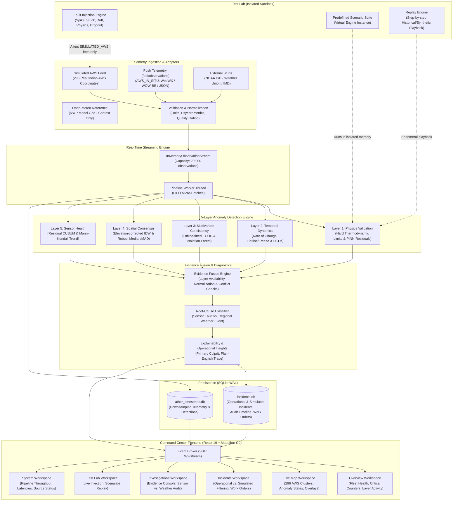

# SkyGuard AI

> **Automatic Weather Station (AWS) Telemetry Monitoring, Multi-Layered Anomaly Response, and Incident Investigation Platform**

[](https://python.org)
[](https://fastapi.tiangolo.com)
[](https://react.dev)
[](https://www.typescriptlang.org/)
[](https://maplibre.org/)
[](https://sqlite.org)

---

## Table of Contents

- [1. Project Overview & Problem Statement](#1-project-overview--problem-statement)
- [2. System Architecture](#2-system-architecture)
- [3. Application Modules & User Workspaces](#3-application-modules--user-workspaces)
- [4. Anomaly Detection Engine (5 Diagnostic Layers)](#4-anomaly-detection-engine-5-diagnostic-layers)
- [5. Evidence Fusion & Root-Cause Diagnosis](#5-evidence-fusion--root-cause-diagnosis)
- [6. Incident Lifecycle & Work Orders](#6-incident-lifecycle--work-orders)
- [7. Test Lab & Live Fault Injection](#7-test-lab--live-fault-injection)
- [8. Data Sources & Provenance](#8-data-sources--provenance)
- [9. Verified Technology Stack](#9-verified-technology-stack)
- [10. Repository Structure](#10-repository-structure)
- [11. Local Installation & Setup](#11-local-installation--setup)
- [12. Configuration & Environment Variables](#12-configuration--environment-variables)
- [13. Running the Application](#13-running-the-application)
- [14. Testing & Validation](#14-testing--validation)
- [15. API Endpoint Reference](#15-api-endpoint-reference)
- [16. Known Limitations & Technical Constraints](#16-known-limitations--technical-constraints)
- [17. Troubleshooting](#17-troubleshooting)

---

## 1. Project Overview & Problem Statement

**SkyGuard AI** is a weather-station telemetry monitoring and anomaly-response platform designed to identify suspicious Automatic Weather Station (AWS) readings, explain potential sensor faults, visualize station health across India, and support investigation through incident management and controlled fault-injection testing.

### The Problem: Unreliable Weather Telemetry
National meteorological operations, agricultural intelligence networks, renewable energy operators, and aviation authorities rely heavily on uncrewed Automatic Weather Stations. Deployed across rugged, remote, and climatically harsh environments, these physical sensor nodes face chronic data-quality issues:
- **Sensor Spikes & Glitches**: Transient electrical surges, analog-to-digital converter glitches, or radio packet corruption produce instant non-physical step changes.
- **Frozen / Stuck Sensors**: Mechanical anemometers freeze under ice or debris; electronic sensors lock up in failure states, flatlining telemetry while appearing "active".
- **Calibration Drift**: Electrochemical hygrometers and thermistors slowly degrade over weeks and months, reporting readings that drift away from true ambient conditions without ever crossing standard range limits.
- **Microclimate & Shield Failures**: Dirt accumulation or failed aspiration fan motors cause artificial heat buildup inside solar radiation shields.
- **Communication Loss**: Intermittent cellular networks or battery exhaustion leave data stale or missing entirely.

### Why Simple Threshold Checks Fail
Static threshold filters (e.g., checking if temperature is between -10°C and 50°C) only catch gross failures. They suffer from two critical flaws:
1. **False Positives on Real Extreme Weather**: A convective storm, microburst, gust front, or squall line causes rapid cooling and violent pressure spikes. Simple rate-of-change checks flag these life-critical events as "sensor defects."
2. **False Negatives on Insidious Faults**: A thermometer drifting 4°C above its true ambient reading stays well within normal climatological bounds, silently corrupting forecasting models, agricultural advisories, and disaster planning.

### How SkyGuard AI Solves This
SkyGuard AI evaluates incoming observations through **five independent diagnostic layers** (Physics, Temporal, Multivariate, Spatial, and Sensor Health). It cross-correlates sensor signals against thermodynamic laws, historical diurnal dynamics, psychrometric multivariate couplings, and spatial neighbor consensus. 

By distinguishing localized instrument malfunctions from regional weather events, SkyGuard AI provides **plain-English diagnostic explanations, heuristic confidence assessments, and persistent incident response workflows** without fabricating data or guessing missing values.

---

## 2. System Architecture

The following diagram illustrates the data flow through SkyGuard AI, from telemetry ingestion and validation to multi-layer detection, evidence fusion, incident management, and presentation in the Command Center. It also highlights how the Test Lab's isolated simulated feed processes faults without contaminating operational telemetry:



---

## 3. Application Modules & User Workspaces

SkyGuard AI organizes operational response into six dedicated workspaces:

### A. Overview Workspace
*Route: `/overview`*
- **Monitored Network Summary**: Real-time snapshot of connected stations, categorized by operational status (`nominal`, `suspect`, `anomaly`, `degraded`).
- **Fleet Metrics & Weather Baseline**: Live network-wide temperature, humidity, and barometric averages computed from active telemetry.
- **Layer Activity Breakdown**: Dynamic counters showing how many stations are currently triggering checks across each of the 5 detection layers.
- **Regional Health Breakdown**: Geographical rollup tracking stations requiring operational attention across Indian states and metropolitan zones.
- **Live Event Feed**: Real-time activity log showing anomaly detections, incident creation, work-order status changes, and pipeline heartbeats.

### B. Live Map Workspace
*Route: `/map`*
- **296 Monitored Indian AWS Stations**: GPU-accelerated MapLibre GL vector canvas plotting stations with dynamic clustering.
- **Visual Station Anomaly States**: Stations are color-coded by health state (Green: Nominal, Amber: Warning/Suspect, Red: Anomaly/Critical, Grey: Degraded/Offline). Stations with active fault simulations feature a distinct purple simulation badge.
- **Multi-Source Basemaps**: Instant toggle between Dark Carto vector tiles and high-resolution Satellite imagery.
- **Meteorological Grid Overlays**: Dynamic rendering of scalar temperature fields and vector wind particles powered by Vane WebGL shaders.
- **Filtering & Selection**: Filter stations by operational severity (`All`, `Anomalous`, `Warning`, `Degraded`, `Nominal`), diagnostic finding (`Sensor fault`, `Weather event`, `Communication`, `Uncertain`), and geographical region. Selecting any station opens the Station Preview Panel with 24-hour diurnal trend sparklines, hardware status, and neighbor proximity links.

### C. Incidents Workspace
*Route: `/incidents`*
- **Operational vs. Simulated Incident Triage**: Clean filter tabs separating real field incidents (`LIVE_AWS`), simulated test lab incidents (`SIMULATED_FEED`), and all combined events.
- **Incident Severity & Status Tracking**: Severity tiers (`CRITICAL`, `WARNING`, `INFO`) and operational lifecycle states (`NEW`, `ACKNOWLEDGED`, `INVESTIGATING`, `ESCALATED`, `RESOLVED`, `DISMISSED`).
- **Escalation Preview**: Generates simulated SMS/email operational dispatches detailing fault signatures, sensor ID, coordinates, and urgency without sending external messages.
- **Work Order Management**: Raise maintenance work orders (`CREATED` → `ASSIGNED` → `IN_PROGRESS` → `COMPLETED`) directly linked to active incidents.
- **Automated Incident Reports**: Formats formal incident engineering reports summarizing observation timestamps, primary failure signals, layer scores, and resolution notes.

### D. Investigations Workspace
*Route: `/investigations`*
- **Incident Evidence Console**: Deep technical forensic investigation interface for confirmed sensor anomalies.
- **Detection-Layer Evidence Matrix**: Full transparency into what each individual layer evaluated, its raw output score, and why it flagged or passed the reading.
- **Timeline & Telemetry Delta**: Displays recorded observations before and at onset of the anomaly, highlighting sudden variance jumps.
- **Sensor vs. Weather Differentiation**: Visual counterfactual evidence demonstrating whether nearby neighbor stations corroborated or contradicted the reading.

### E. Test Lab Workspace
*Route: `/test-lab`*
- **Scenario Suite**: 10 predefined synthetic fault scenarios (frozen sensors, radiation overheating, microbursts, calibration drift) executed inside an isolated detector instance. Outcomes are compared against documented hypotheses (`Matches` or `Differs`) without modifying production state.
- **Live Fault Injection**: Directly inject configurable faults into the simulated Indian AWS feed and observe detection latency in real time.
- **Replay Engine**: Step-by-step virtual clock playback of recorded station history or synthetic fault sequences through a fresh pipeline instance, rendering parameter curves, layer strips, and timeline markers.

### F. System Workspace
*Route: `/system`*
- **Pipeline Health & Telemetry Metrics**: Monitors ingestion latency, stream buffer lag, detection engine processing time, and end-to-end latency.
- **Telemetry Source Status**: Explicit visibility into all registered sources (Simulated AWS, Open-Meteo Reference, NOAA ISD, Weather Union, IMD Push), reporting exact polling cadence, active station counts, or configuration requirements.

---

## 4. Anomaly Detection Engine (5 Diagnostic Layers)

Every observation evaluated by SkyGuard AI is processed through five specialized analytical layers:

```
Observation Telemetry (T, P, RH, Wind)
         │
         ├───▶ [Layer 1: Physics Validation]        Rule-based bounds + PINN autoencoder
         ├───▶ [Layer 2: Temporal Dynamics]         Numerical derivatives + LSTM residual
         ├───▶ [Layer 3: Multivariate Consistency]  Offline-trained ECOD + Isolation Forest
         ├───▶ [Layer 4: Spatial Consensus]         IDW consensus + Robust Median/MAD
         └───▶ [Layer 5: Sensor Drift & Health]     Weather-independent CUSUM + Mann-Kendall
```

### Layer 1: Physics Validation
- **Purpose**: Enforce absolute thermodynamic and meteorological laws based on World Meteorological Organization (WMO-No. 8) standards.
- **Implementation**:
  - **Hard Rule-Based Bounds**: Verifies physical operating limits:
    - Air Temperature: $-45^\circ\text{C} \le T \le 50^\circ\text{C}$
    - Atmospheric Pressure: $920\,\text{hPa} \le P \le 1065\,\text{hPa}$
    - Relative Humidity: $0\% \le \text{RH} \le 100\%$
    - Wind Speeds: Flag gale ($>75\,\text{km/h}$) and storm ($>100\,\text{km/h}$) levels.
  - **Thermodynamic Consistency**: Computes dew point ($T_{\text{dew}}$) and wet-bulb temperature ($T_{\text{wb}}$) using MetPy/Magnus approximations. Enforces $T_{\text{dew}} \le T_{\text{air}} + 0.5^\circ\text{C}$ and $T_{\text{wb}} \le 35^\circ\text{C}$ (theoretical survivability limit).
  - **Hypsometric Altitude Consistency**: Compares measured barometric pressure against the International Standard Atmosphere barometric formula for station elevation; deviations $>8\%$ are flagged.
  - **Physics-Informed Neural Network (PINN)**: When PyTorch is enabled, a lightweight 4-feature denoising autoencoder trained with a custom physics loss function ($\mathcal{L} = \mathcal{L}_{\text{data}} + 0.3\mathcal{L}_{\text{physics}}$) evaluates joint consistency and supplies reconstruction residuals for self-healing imputation.
- **Authority**: Rule violations trigger a **hard physics veto**, immediately scoring 1.0 and declaring an anomaly. Missing or unconfigured channels are never treated as physics violations.

### Layer 2: Temporal Dynamics
- **Purpose**: Detect anomalous step changes, rapid kinematic spikes, electronic flatlines, and temporal rate-of-change failures.
- **Implementation**:
  - **Rate of Change ($\Delta x / \Delta t$)**: Computes 1st numerical derivatives across consecutive valid readings spaced by true observation timestamps. Thresholds for standard 10-minute intervals:
    - Temperature: $|\Delta T| \le 3.5^\circ\text{C}$
    - Pressure: $|\Delta P| \le 2.5\,\text{hPa}$
    - Humidity: $|\Delta \text{RH}| \le 15\%$
  - **Frozen / Stuck Sensor**: Identifies sensors reporting identical values over a minimum span (default: 60 minutes, configurable via `ATHER_FROZEN_MIN_SPAN_MIN`) with sample variance $< 10^{-6}$.
  - **Rolling Robust Z-Score**: Computes modified Z-score using Median Absolute Deviation (MAD) over a 12-hour rolling buffer (72 samples), enforcing sensor measurement uncertainty noise floors ($0.2^\circ\text{C}$, $0.15\,\text{hPa}$, $1.0\%\,\text{RH}$) to prevent false alarms during quiet nocturnal periods.
  - **LSTM Temporal Residuals**: Optional 2-layer LSTM model ($144 \times 3$ sequence window = 24 hours of 10-minute steps) predicting next-step values for temperature, pressure, and humidity. Residuals are normalized by Stage 3/5 calibrated P99 thresholds.

### Layer 3: Multivariate Consistency
- **Purpose**: Verify that coupled atmospheric parameters move in psychrometrically and aerodynamically plausible combinations.
- **Implementation**:
  - **Machine-Learning Detectors**: Uses empirical models fitted offline using PyOD and scikit-learn on historical Indian AWS records (stored in `backend/models/multivariate_ecod_if/`):
    - **ECOD (Empirical Cumulative Distribution Functions for Outlier Detection)**: Computes multi-dimensional tail probabilities.
    - **Isolation Forest**: Tree-based ensemble partitioning multivariate feature space.
  - **Features**: Joint 3D feature vectors: robust Z-scores of temperature, sea-level-equivalent barometric pressure (resolved using hypsometric normalization), and relative humidity conditioned on the nearest reference city baseline within 75 km.
  - **Deterministic Rules**: Fallback Clausius-Clapeyron consistency rule (flags combinations of $T > 32^\circ\text{C}$ with $\text{RH} > 95\%$ in continental climates).

### Layer 4: Spatial Consensus
- **Purpose**: Contrast station telemetry against immediate geographical neighbors to determine whether an abnormal reading is an isolated sensor defect or a shared regional meteorological event.
- **Implementation**:
  - **Neighbor Selection**: Dynamically identifies the $k$-nearest active stations within a 250 km radius (default $k=8$) using Haversine geodesic distance, requiring observation timestamps within 30 minutes of each other.
  - **Inverse-Distance-Weighted (IDW) Consensus**: Interpolates expected values using elevation lapse-rate adjustments ($6.5^\circ\text{C}/\text{km}$ temperature drop, barometric hypsometric correction).
  - **Robust Statistics**: Concurrently calculates regional median and Median Absolute Deviation (MAD) across neighbors.
  - **Regional Attribution & Counterfactual Verification**: When a station deviates, the layer analyzes whether neighbors exhibit correlated shifts. If neighbors move in unison, the event is classified as a genuine regional weather event. If the station deviates alone while neighbors remain stable, it is classified as an isolated sensor fault.

### Layer 5: Sensor Drift & Health Tracking
- **Purpose**: Detect insidious, long-term calibration loss and mechanical sensor wear that evade instantaneous threshold checks.
- **Implementation**:
  - **Weather-Independent Residual Tracking**: Rather than tracking raw sensor readings (which fluctuate diurnally), Layer 5 tracks the **residual** between the sensor and its local spatial neighbor consensus ($x_{\text{obs}} - x_{\text{spatial}}$), removing the common-mode diurnal weather signal.
  - **CUSUM Control Charts**: Maintains dual positive and negative Cumulative Sum accumulators with exponential forgetting ($\beta=0.97$) and leak factors ($0.98$) per channel. Outliers are clipped to prevent single spikes from dominating the drift metric.
  - **Mann-Kendall Trend Test**: Evaluates monotonic trend significance ($\tau$ correlation vs. time, requiring $p < 0.01$).
  - **Health Index & Degradation Tiers**: Categorizes sensor health into five tiers (`NORMAL`, `SUSPICIOUS`, `POSSIBLE_DRIFT`, `LIKELY_DRIFT`, `HIGH_RISK`). Projects days until tolerance breach only when statistically significant trends persist.

---

## 5. Evidence Fusion & Root-Cause Diagnosis

SkyGuard AI combines diagnostic layer outputs through an evidence-aware fusion architecture:

```
[Layer 1..5 Scores & Validity] ──▶ [ConformalEvidenceFusion] ──▶ [RootCauseClassifier] ──▶ Anomaly Alert & Incident
```

### Fusion Logic
1. **Layer Availability Gating**: Layers that lack sufficient historical data, spatial neighbors, or sensor channels report `INSUFFICIENT_DATA` or `UNAVAILABLE`. They are cleanly excluded from the ensemble and their weights are renormalized. Missing layers never receive an artificial score of 0.
2. **Physics Short-Circuit**: A hard physics veto (Layer 1 violation) immediately forces the anomaly status to `ANOMALY` with maximum severity.
3. **Acute vs. Health Separation**: Acute anomaly evidence (Layers 1–4) is weighted into an ensemble score:
   $$\text{Severity} = 0.6 \times \max(\text{Acute Layers}) + 0.4 \times \text{Weighted Ensemble}$$
   Layer 5 (Sensor Drift) is treated as a persistent health metric. It cannot trigger an acute critical alarm on its own; instead, it raises a maintenance `WARNING`.
4. **Heuristic Confidence Scoring**: Confidence is a **heuristic evidence-quality score in $[0, 1]$** (not a calibrated Bayesian probability). It reflects:
   - Corroboration across independent layers (1 layer: capped at 0.65; 2 layers: capped at 0.80; 3+ layers: up to 0.95).
   - Downward penalties when spatial consensus contradicts the finding.
   - Penalties when multiple layers are unavailable due to data gaps.

### Root-Cause Taxonomy
The `RootCauseClassifier` applies decision trees to categorize anomalous findings:
- `PHYSICAL_IMPOSSIBILITY`: Rule violation in temperature, pressure, or psychrometric limits.
- `FROZEN_SENSOR`: Consecutive readings with zero variance spanning over 60 minutes.
- `SENSOR_SPIKE`: Severe instantaneous step change isolated to a single station.
- `CALIBRATION_DRIFT`: Progressive CUSUM accumulation accompanied by spatial neighbor disagreement.
- `GENUINE_EXTREME_WEATHER`: High temporal rate of change corroborated by neighboring stations and adhering to physical bounds.
- `POSSIBLE_WEATHER_CHANGE`: Moderate rate of change with partial spatial agreement.
- `COMMUNICATION_OUTAGE`: Data stale or missing across expected transmission windows.
- `INSUFFICIENT_EVIDENCE`: Telemetry flagged as atypical, but with too few active layers or neighbors to assign a definitive fault type.

---

## 6. Incident Lifecycle & Work Orders

Operational incidents are managed by a persistent state machine backed by SQLite in Write-Ahead Logging (WAL) mode:

```
   [ NEW ] ──────────────────────────────▶ [ DISMISSED ]
      │                                          ▲
      ▼                                          │
[ ACKNOWLEDGED ] ────────────────────────────────┤
      │                                          │
      ▼                                          │
[ INVESTIGATING ] ───▶ [ ESCALATED ] ────────────┤
      │                     │                    │
      ▼                     ▼                    │
      └──────────────▶ [ RESOLVED ] ─────────────┘
```

### Operational State Transitions
- **`NEW`**: Automatically opened by the backend pipeline when an Indian AWS observation produces an actionable anomaly score ($\ge 0.55$).
- **`ACKNOWLEDGED`**: Operator confirms awareness of the alarm.
- **`INVESTIGATING`**: Technical review underway; evidence linked to the investigation console.
- **`ESCALATED`**: Escalated to field engineering. Generates an escalation alert preview detailing station ID, region, fault type, and sensor telemetry.
- **`RESOLVED`**: Closed with mandatory operator notes and resolution classification (e.g., Sensor Replaced, Sensor Recalibrated, False Alarm Verified).
- **`DISMISSED`**: Dismissed as non-actionable or transient with documented justification.

### Maintenance Work Orders
Operators can attach formal maintenance work orders to any open incident via `/api/incidents/{id}/work-orders`:
- States: `CREATED` $\rightarrow$ `ASSIGNED` $\rightarrow$ `IN_PROGRESS` $\rightarrow$ `COMPLETED`.
- Tracks assigned engineering teams, priority levels (`LOW`, `MEDIUM`, `HIGH`, `URGENT`), and notes.
- Every state advancement is logged directly to the incident's immutable timeline.

---

## 7. Test Lab & Live Fault Injection

The Test Lab provides safe verification of anomaly detection capabilities without contaminating operational telemetry.

### A. Predefined Scenario Suite
Located in `backend/app/simulation/scenarios.py`, the suite runs 10 reproducible scenarios through an isolated instance of `AnomalyDetector`:
1. `temp_spike_single`: High-magnitude temperature spike testing Layer 2 and Layer 4 isolation.
2. `frozen_pressure_sensor`: Unchanging barometric pressure over 12 cycles testing persistence checks.
3. `severe_microburst`: Co-located temperature drops, pressure rises, and wind gusts with simulated neighbor agreement, verifying extreme weather classification.
4. `radiation_shield_overheating`: Daytime temperature escalation testing multivariate decoupling.
5. `gradual_temp_drift`: Multi-hour progressive calibration drift testing Layer 5 CUSUM accumulation.
6. `transient_pressure_spike`: Step change that recovers to normal, testing recovery recognition.
7. `impossible_rh_reading`: Humidity above 100%, triggering a Layer 1 physics veto.
8. `missing_telemetry_packet`: Null telemetry channels testing data-quality gating and insufficient-evidence handling.
9. `combined_failure_sensor_drift`: Temperature drift coupled with barometric noise.
10. `regional_cold_front`: Multi-station regional cooling verifying neighbor consensus.

### B. Live Fault Injection Workflow
Operators can inject synthetic faults directly into the real-time simulation feed from the UI or API:

```
1. Select Monitored Indian AWS Station (e.g., Koramangala AWS)
2. Choose Fault Type & Target Parameter (e.g., Spike on Temperature)
3. Set Severity (low, medium, high) & Duration (minutes)
4. POST /api/lab/faults (Injected into isolated SIMULATED_AWS feed)
5. Observation streams into real-time detection pipeline
6. Live Map marks station with purple simulation indicator
7. Anomaly detected & linked incident appears in Simulated / Fault Injection tab
```

#### Supported Fault Types:
| Fault Type ID | Target Parameters | Expected Layers | Expected Interpretation | Description |
|:---|:---|:---|:---|:---|
| `spike` | `temperature`, `humidity`, `pressure` | L2, L4 | `likely_sensor_fault` | Step offset on one channel; neighbors unaffected. |
| `stuck` | `temperature`, `humidity`, `pressure` | L2 | `likely_sensor_fault` | Channel freezes at current value; triggers after minimum span. |
| `drift` | `temperature`, `humidity`, `pressure` | L4, L5, L2 | `likely_sensor_fault` | Linearly growing bias ($1.5^\circ\text{C}$ to $6.0^\circ\text{C}$/hr) caught by CUSUM. |
| `impossible_rh` | `humidity` | L1 | `likely_sensor_fault` | Relative humidity forced above 100% (hard physics veto). |
| `t_rh_inconsistency` | `humidity` | L1 | `likely_sensor_fault` | Dew point forced above measured temperature. |
| `missing` | `temperature`, `humidity`, `pressure` | None | `degraded` | Channel stops reporting; station marked degraded. |
| `dropout` | None (All channels) | None | `communication_issue` | Station stops transmitting entirely; triggers stale watchdog. |
| `regional_event` | All channels (Radius) | L2 | `likely_weather_event` | Coherent multi-station shift; spatial consensus verifies weather. |

#### Simulation Isolation Guarantee:
- Every injected observation is tagged `source="SIMULATED_AWS"`.
- Qualifying detections open incidents tagged `source="SIMULATED_FEED"`.
- Operational incident counters and default views (`source="LIVE_AWS"`) are strictly isolated from test injections.

---

## 8. Data Sources & Provenance

SkyGuard AI enforces strict data provenance across all displayed and evaluated weather parameters:

| Data Source | Status in Application | Description & Provenance |
|:---|:---|:---|
| **Indian AWS Network** (296 Stations) | **Active (Simulated Feed)** | 296 genuine Indian AWS coordinates loaded from `backend/WeatherUnionInfra.csv`. Because no public real-time API exists for raw IMD AWS feeds, telemetry is generated by `SimulationAdapter` using solar diurnal models anchored to real geographic locations. Tagged `SIMULATED_AWS`. |
| **Open-Meteo Reference** | **Active (Reference Only)** | Localized numerical weather prediction (NWP) model data fetched from Open-Meteo API. Used strictly as a background meteorological reference for baseline comparisons. **Never treated as a measured station observation.** |
| **Push Telemetry** (`/api/observations`) | **Active (Operational)** | Ingestion endpoint accepting external in-situ AWS packets in WeeWX, WOW-BE, or native JSON format. Processed as genuine operational telemetry (`AWS_IN_SITU`). |
| **NOAA ISD** | **Optional (Opt-In)** | Global-hourly surface observations from NOAA NCEI. Requires setting `ATHER_NOAA_STATIONS` with 11-digit USAF+WBAN identifiers. Operates with archive publication lag. |
| **Weather Union Locality API** | **Unconfigured (Stubbed)** | Adapter implemented against the v0 endpoint (`/get_locality_weather_data`). Inactive until a valid `WEATHERUNION_API_KEY` is provided on the server. |
| **IMD AWS / ARG Network** | **Unavailable (No Public API)** | Registered as an intended source stub. IMD does not provide an open real-time API; integration is supported via push ingestion into `/api/observations`. |
| **Global Station Catalogue** (1,650+ Stations) | **Static Snapshot** | Static metadata in `data/stations.json` from historic mesonet archives. Marked as `freshness: UNKNOWN` and excluded from operational live incident queues. |

---

## 9. Verified Technology Stack

### Frontend
- **Framework**: React 19 (`react` 19.0.0, `react-dom` 19.0.0)
- **Language**: TypeScript (`typescript` 5.7.3)
- **Build Tool & Dev Server**: Vite 6.1 (`vite`, `@vitejs/plugin-react`)
- **Mapping & GPU Rendering**: MapLibre GL 5.6 (`maplibre-gl`), custom WebGL particle shaders (`vane`)
- **Icons**: Lucide React (`lucide-react` 0.475.0)
- **Styling**: Vanilla CSS with customized design system (`styles/ather-theme.css`, `index.css`)

### Backend
- **Framework & ASGI Server**: FastAPI 0.110+ (`fastapi`), Uvicorn 0.28+ (`uvicorn`)
- **Data Validation & Schemas**: Pydantic 2.0+ (`pydantic`)
- **Runtime**: Python 3.10+ (tested on Python 3.10, 3.11, 3.12, 3.14)

### Data Processing & Scientific Computing
- **Array & Numerical Processing**: NumPy 1.24+ (`numpy`), SciPy 1.10+ (`scipy`)
- **Tabular Data**: Pandas 2.0+ (`pandas`)
- **Meteorological Calculations**: MetPy 1.5+ (`metpy`)
- **Machine Learning & Outlier Detection**:
  - Scikit-learn 1.6+ (`scikit-learn`) — Isolation Forest, decision tree structures
  - PyOD 1.1+ (`pyod`) — Empirical Cumulative Distribution Outlier Detection (ECOD)
  - PyTorch 2.0+ (`torch`) — Physics-Informed Neural Network (PINN) autoencoder and temporal LSTM networks (optional, can be toggled via `ATHER_ENABLE_TORCH`)

### Persistence & Storage
- **Database Engine**: Python standard library `sqlite3` in Write-Ahead Logging (`PRAGMA journal_mode=WAL;`) mode:
  - `data/incidents.db`: Operational and simulated incidents, timeline history, and maintenance work orders.
  - `data/ather_timeseries.db`: Rolling raw telemetry observations and detection results.
- **In-Memory Streaming**: `InMemoryObservationStream` with asynchronous worker queues and Server-Sent Events (SSE) broadcasting.

---

## 10. Repository Structure

```
ather-weather-anomaly-detection/
├── backend/
│   ├── app/
│   │   ├── anomaly/            # Anomaly detector coordinator (detector.py)
│   │   ├── incidents/          # Incident persistence, SQLite schema, work orders
│   │   ├── ingestion/          # Multi-protocol parser (WeeWX, WOW-BE, native)
│   │   ├── pipeline/           # Real-time streaming runtime, broker, SQLite store
│   │   ├── simulation/         # Test Lab scenario engine (scenarios.py, service.py)
│   │   ├── sources/            # Telemetry source adapters (simulation, NOAA, stubs)
│   │   ├── stations/           # Station metadata service, registry & CSV parser
│   │   ├── weather/            # Open-Meteo client & meteorological grid service
│   │   └── main.py             # FastAPI entry point & API route definitions
│   ├── engine/                 # Core 5-Layer Detection Implementations
│   │   ├── layer1_physics.py       # Physics checks, bounds, and PINN integration
│   │   ├── layer2_temporal.py      # Derivatives, flatline freeze, LSTM residual
│   │   ├── layer3_multivariate.py  # ECOD & Isolation Forest runtime inference
│   │   ├── layer4_spatial.py       # IDW consensus & neighbor correlation
│   │   ├── layer5_drift.py         # Weather-independent residual CUSUM & Mann-Kendall
│   │   ├── lstm_temporal.py        # LSTM neural network evaluation wrapper
│   │   ├── spatial_neighbors.py    # Geodesic radius search & neighbor ranking
│   │   └── spatial_attribution.py  # Sensor-vs-weather counterfactual attribution
│   ├── fusion/                 # Evidence fusion engine (conformal_fusion.py)
│   ├── models/                 # Pretrained ML model artifacts (ECOD, IF, LSTM)
│   ├── root_cause/             # Classifier, explainability & self-healing imputation
│   ├── tests/                  # 31 automated test suites covering engine & pipeline
│   ├── config.py               # Central thresholds and dataclass configuration
│   ├── requirements.txt        # Backend Python dependencies
│   ├── run.py                  # Uvicorn launcher script (port 8001)
│   ├── schema.py               # Pydantic data models & internal schemas
│   └── WeatherUnionInfra.csv   # Authoritative catalogue of 296 Indian AWS stations
├── frontend/
│   ├── src/
│   │   ├── components/         # Modals, navigation, and workspace sub-panels
│   │   │   ├── intel/          # Investigation console & scenario suite cards
│   │   │   ├── live/           # Live status badges, event strips & counters
│   │   │   └── ops/            # Incident report & work-order management cards
│   │   ├── map/                # MapLibre GL canvas, markers, and WebGL overlays
│   │   ├── pages/              # Landing page (HomePage.tsx)
│   │   ├── services/           # REST API client & SSE real-time stream hook
│   │   ├── styles/             # Design tokens and themes (ather-theme.css)
│   │   ├── types/              # TypeScript interface definitions
│   │   ├── workspaces/         # Workspaces: Overview, Map, Incidents, Test Lab, etc.
│   │   ├── App.tsx             # Root React component & routing shell
│   │   └── main.tsx            # React application mount
│   ├── package.json            # Frontend dependencies & npm scripts
│   ├── tsconfig.json           # TypeScript configuration
│   └── vite.config.ts          # Vite configuration with API proxy to port 8001
├── data/                       # Local runtime database files (incidents.db, stations.json)
├── docs/                       # Architecture and UI specification documents
├── run_ather.sh                # Consolidated startup script for backend & frontend
└── .env.example                # Documented configuration template
```

---

## 11. Local Installation & Setup

### Prerequisites
- **Python**: Version 3.10 or higher (`python3 --version`)
- **Node.js**: Version 18.0.0 or higher (`node --version`)
- **npm**: Version 9.0.0 or higher (`npm --version`)
- **Git**: For repository cloning

### Installation Steps

1. **Clone the repository**:
   ```bash
   git clone https://github.com/gdhanushkumar07/ather-weather-anomaly-detection.git
   cd ather-weather-anomaly-detection
   ```

2. **Backend Setup**:
   Navigate to the `backend` directory, set up a virtual environment, and install dependencies:
   ```bash
   cd backend
   python3 -m venv venv
   source venv/bin/activate
   # On Windows: venv\Scripts\activate

   pip install --upgrade pip
   pip install -r requirements.txt
   cd ..
   ```

3. **Frontend Setup**:
   Navigate to the `frontend` directory and install npm packages:
   ```bash
   cd frontend
   npm install
   cd ..
   ```

4. **Environment Configuration**:
   Create a local configuration file from the template:
   ```bash
   cp .env.example .env
   ```

---

## 12. Configuration & Environment Variables

All settings have safe, working defaults for local development. Configure custom overrides in `.env`:

| Environment Variable | Type | Default | Required? | Purpose |
|:---|:---|:---|:---:|:---|
| `HOST` | String | `0.0.0.0` | Optional | Backend binding address. |
| `PORT` | Integer | `8001` | Optional | Backend HTTP port (must match Vite proxy). |
| `ATHER_PIPELINE_ENABLED` | Boolean (0/1) | `1` | Optional | Starts the real-time background streaming pipeline on app startup. |
| `ATHER_SIM_ENABLED` | Boolean (0/1) | `1` | Optional | Enables continuous synthetic observation generation for the 296 AWS network. |
| `ATHER_REFERENCE_ENABLED` | Boolean (0/1) | `1` | Optional | Enables background Open-Meteo reference polling for meteorological baselines. |
| `ATHER_SIM_INTERVAL_S` | Float | `60` | Optional | Telemetry generation cadence per station (default: 60s; 600s recommended on constrained servers). |
| `ATHER_ENABLE_TORCH` | Boolean (0/1) | `1` | Optional | Set to `0` in memory-constrained environments (e.g. 512MB RAM) to disable PyTorch PINN/LSTM loading and prevent OOM errors. |
| `ATHER_INCIDENTS_DB_PATH` | Path | `data/incidents.db` | Optional | Filesystem path for the SQLite incidents database. |
| `ATHER_TIMESERIES_DB_PATH`| Path | `data/ather_timeseries.db` | Optional | Filesystem path for the SQLite time-series telemetry store. |
| `ATHER_INGEST_TOKEN` | String | `""` | Optional | Shared authentication secret required in `X-ATHER-Token` header for `/api/observations`. |
| `OPEN_METEO_API_KEY` | String | `""` | Optional | Commercial Open-Meteo key for high-volume upstream API quotas. |
| `WEATHERUNION_API_KEY` | String | `""` | Optional | Server-side key for polling Weather Union locality endpoints. |
| `ATHER_NOAA_STATIONS` | String | `""` | Optional | Comma-separated USAF+WBAN station IDs for NOAA ISD ingestion. |
| `WEATHER_LOG_LEVEL` | String | `INFO` | Optional | Logging level (`DEBUG`, `INFO`, `WARNING`, `ERROR`). |
| `ATHER_API_TARGET` | String | `http://127.0.0.1:8001`| Optional | Frontend dev proxy destination configured in `vite.config.ts`. |

---

## 13. Running the Application

### Option A: One-Command Startup (Recommended)
From the repository root directory, run the consolidated launcher script:
```bash
chmod +x run_ather.sh
./run_ather.sh
```
This script launches the FastAPI backend on port 8001 and starts the Vite frontend dev server on port 3000. Press `Ctrl+C` to terminate both services cleanly.

### Option B: Manual Two-Terminal Startup

**Terminal 1 — Backend API Server**:
```bash
cd backend
source venv/bin/activate
python3 run.py
```
*Backend runs on `http://localhost:8001` with Swagger interactive documentation available at `http://localhost:8001/docs`.*

**Terminal 2 — Frontend Development Server**:
```bash
cd frontend
npm run dev
```
*Frontend runs on `http://localhost:3000`.*

---

## 14. Testing & Validation

The repository includes comprehensive automated test suites covering all detection layers, evidence fusion, and the streaming pipeline:

### Running Backend Unit & Integration Tests
```bash
# Run the core backend and station scope tests
python3 -m pytest backend/tests/test_backend.py backend/tests/test_indian_station_scope.py -v

# Run the full test suite
python3 -m pytest backend/tests -v
```

### Key Verified Test Suites:
- `test_backend.py`: Validates station GeoJSON generation, Indian AWS ingestion, and API endpoints.
- `test_indian_station_scope.py`: Verifies that operational incidents and counts are strictly scoped to the 296 monitored Indian AWS stations.
- `test_anomaly_engine.py`: Tests physical bounds, temporal rates, and psychrometric relations.
- `test_multivariate_ecod_if.py`: Validates ECOD tail probabilities and Isolation Forest outlier scoring.
- `test_spatial_clustering.py` & `test_spatial_attribution.py`: Tests IDW consensus, MAD bounds, and counterfactual neighbor attribution.
- `test_sensor_health_cusum.py`: Tests residual CUSUM accumulation and drift tier boundaries.
- `test_simulation.py`: Verifies sandbox isolation and non-interference of test faults with operational data.
- `test_realtime.py`: Validates end-to-end ingestion, stream queues, SSE event delivery, and incident lifecycle transitions.

### Frontend Type-Checking & Production Build
```bash
cd frontend
npm run build
```
*Executes `tsc` type-checking followed by Vite production bundling into `frontend/dist/`.*

---

## 15. API Endpoint Reference

| Method | Endpoint | Description |
|:---|:---|:---|
| `GET` | `/api/health` | Service health status, version, and count of loaded stations. |
| `GET` | `/api/stations` | GeoJSON FeatureCollection of stations supporting bounding-box filtering (`min_lon`, `min_lat`, `max_lon`, `max_lat`). |
| `GET` | `/api/stations/search` | Search stations by name, town, region, or station ID. |
| `GET` | `/api/stations/{id}` | Detailed metadata and current telemetry for a specific station. |
| `GET` | `/api/stations/{id}/observations` | Historical time-series observation trends for charts and sparklines. |
| `GET` | `/api/stations/{id}/anomaly` | Detailed anomaly scores and diagnostic breakdown across all 5 layers. |
| `GET` | `/api/stations/{id}/debug` | Complete forensic trace: Raw values $\rightarrow$ Normalized reading $\rightarrow$ 5-layer outputs $\rightarrow$ Fusion $\rightarrow$ Diagnosis. |
| `GET` | `/api/stream` | Server-Sent Events (SSE) stream for real-time station updates, anomalies, and incidents. |
| `GET` | `/api/network/state` | Current fleet state snapshot and event sequence ID for stream resumption. |
| `GET` | `/api/system/health` | Pipeline runtime diagnostics, component health, and latency statistics. |
| `GET` | `/api/sources` | Ingestion adapter status and data-flow states. |
| `POST` | `/api/observations` | Push ingestion endpoint for validated in-situ telemetry (supports `X-ATHER-Token`). |
| `POST` | `/api/ingest` | Legacy multi-protocol ingestion endpoint (WeeWX, WOW-BE, native). |
| `GET` | `/api/incidents` | List persisted incidents with filtering by status, source (`LIVE_AWS`, `SIMULATED_FEED`), and station ID. |
| `GET` | `/api/incidents/active-counts`| Real-time operational incident counts scoped to the 296 Indian AWS network. |
| `GET` | `/api/incidents/{id}` | Detailed incident record, context, and timeline history. |
| `POST` | `/api/incidents/{id}/acknowledge` | Acknowledge active incident (state transition). |
| `POST` | `/api/incidents/{id}/investigate` | Transition incident to investigating state. |
| `POST` | `/api/incidents/{id}/escalate` | Escalate incident to engineering. |
| `POST` | `/api/incidents/{id}/resolve` | Resolve incident with mandatory notes and resolution category. |
| `POST` | `/api/incidents/{id}/dismiss` | Dismiss incident with documented justification. |
| `GET` | `/api/incidents/{id}/escalation-preview` | Preview formatted dispatch notification without sending external messages. |
| `GET` | `/api/incidents/{id}/work-orders` | List maintenance work orders associated with an incident. |
| `POST` | `/api/incidents/{id}/work-orders` | Create a new maintenance work order. |
| `POST` | `/api/work-orders/{id}/status` | Advance work order status (`CREATED` $\rightarrow$ `ASSIGNED` $\rightarrow$ `IN_PROGRESS` $\rightarrow$ `COMPLETED`). |
| `GET` | `/api/simulation/scenarios` | List predefined Test Lab fault-injection scenarios. |
| `POST` | `/api/simulation/run` | Execute a sandbox scenario through an isolated detector instance. |
| `GET` | `/api/lab/fault-types` | Catalogue of supported fault injection types and target channels. |
| `GET` | `/api/lab/faults` | List active injected faults in the simulated feed. |
| `POST` | `/api/lab/faults` | Inject a fault into the simulated feed for a specified station and duration. |
| `DELETE`| `/api/lab/faults/{id}` | Cancel an active fault injection. |
| `POST` | `/api/replay` | Initiate step-by-step playback of historical or synthetic observations. |
| `GET` | `/api/weather/metadata` | Meteorological grid dimensions and coordinates for map rendering. |
| `GET` | `/api/weather/grid` | Gridded meteorological scalar/vector fields (temperature, wind) for WebGL canvas. |

---

## 16. Known Limitations & Technical Constraints

1. **Simulated Telemetry for Indian AWS Stations**: The 296 Indian AWS locations represent verified, real-world stations from `WeatherUnionInfra.csv`. However, because no public, unrestricted real-time telemetry API exists for the IMD AWS network, current telemetry values are generated using realistic physical simulation models anchored to real geographic coordinates. They must not be interpreted as physical live sensor feeds.
2. **Open-Meteo Is a Model Reference**: Open-Meteo data is derived from Numerical Weather Prediction (NWP) model runs. SkyGuard AI uses it strictly as an environmental reference baseline, never as an empirical in-situ sensor reading.
3. **Single-Process SQLite Concurrency**: Persistence relies on standard-library `sqlite3` in WAL mode. While suitable for single-node deployments and hackathon demonstrations, enterprise high-frequency mesonet ingest (thousands of simultaneous writes per second) would require migrating the `TimeSeriesStore` interface to TimescaleDB or PostgreSQL.
4. **PyTorch Memory Footprint**: Loading PyTorch neural network weights for the optional PINN and LSTM models requires ~400MB of RAM. On memory-constrained servers (such as Render's 512MB free tier), running PyTorch can cause out-of-memory errors; set `ATHER_ENABLE_TORCH=0` to run in lightweight rule-based and scikit-learn mode.
5. **Heuristic Confidence Scores**: Diagnostic confidence values represent heuristic evidence-quality indices based on multi-layer agreement and data availability. They do not constitute calibrated Bayesian posterior probabilities.

---

## 17. Troubleshooting

### Port Conflicts
- **Problem**: Backend fails to start with `OSError: [Errno 48] Address already in use`.
- **Solution**: Another process is occupying port 8001 or 3000. Identify and terminate it:
  ```bash
  lsof -ti :8001 | xargs kill -9
  lsof -ti :3000 | xargs kill -9
  ```

### Missing Python Dependencies
- **Problem**: `ModuleNotFoundError: No module named 'fastapi'` or `metpy`.
- **Solution**: Ensure your virtual environment is active before starting the server or running tests:
  ```bash
  source backend/venv/bin/activate
  pip install -r backend/requirements.txt
  ```

### Scikit-Learn Model Version Warnings
- **Problem**: Warning `InconsistentVersionWarning: Trying to unpickle estimator IsolationForest from version 1.6.1`.
- **Solution**: The offline multivariate models were trained with scikit-learn 1.6.1. If running a newer version of scikit-learn, the models load and run successfully with a non-fatal warning. To re-fit the models under your installed scikit-learn version, execute:
  ```bash
  python3 backend/multivariate_training/train_models.py
  ```

### Low Memory Server Hangs / 502 Bad Gateway
- **Problem**: The backend is killed by the OS (OOM) on startup on low-memory cloud hosts.
- **Solution**: Disable PyTorch in `.env`:
  ```bash
  export ATHER_ENABLE_TORCH=0
  export ATHER_DEFER_STARTUP_EVAL=1
  ```

---

<div align="center">
  <sub>SkyGuard AI • Intelligent Meteorological Telemetry & Anomaly-Response Platform</sub>
</div>
